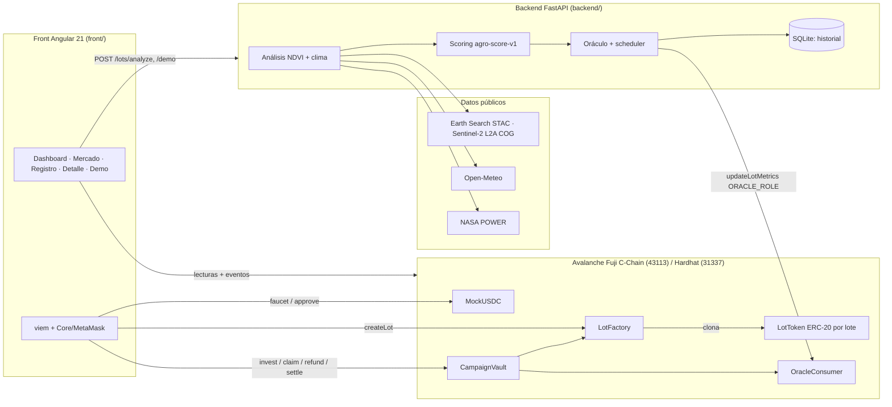

# AgroToken · saltaSpace

> **Prototipo MVP.** Los lotes y tokens son **simulados**; no hay tokenización legal, oferta pública ni valor real. Solo Avalanche Fuji / red local.

AgroToken es un prototipo de hackathon (48 h) de tokenización B2B de activos agrícolas (RWA) del norte argentino sobre **Avalanche**. El activo es simulado, pero su comportamiento financiero depende de **datos reales**: NDVI de Sentinel‑2 y clima de Open‑Meteo / NASA POWER.

1. El productor registra un lote (polígono en el mapa) y el backend lo analiza con datos satelitales.
2. Se crea una campaña on-chain con un token ERC‑20 propio del lote.
3. Los inversores compran fracciones con USDC de prueba; al llegar a la meta, el productor recibe el capital antes de cosechar.
4. Un oráculo publica NDVI, riesgo e índice de rendimiento; al vencimiento, el contrato liquida el pago según esos datos (penalización por sequía, piso y techo).

## Arquitectura



| Carpeta | Contenido |
|---|---|
| `contracts/` | Solidity 0.8.24 + Hardhat TS + OpenZeppelin v5: `MockUSDC`, `LotFactory`, `LotToken` (clones EIP‑1167), `CampaignVault`, `OracleConsumer`. Tests, deploy, seed y export de ABIs. |
| `backend/` | Python 3.11, FastAPI, pystac-client, rasterio/numpy, httpx, web3.py, APScheduler. |
| `front/` | Angular 21 standalone + SSR, Tailwind v4, viem, Leaflet, Chart.js. |
| `docs/` | [Fórmulas](docs/scoring.md), [deploy en Fuji](docs/deploy-fuji.md), [deploy en una L1](docs/deploy-l1.md), [guion de demo](docs/demo-script.md). |

### Contratos

- **`LotFactory`**: crea lotes (productor, nombre, cultivo, hectáreas, GeoJSON + `geoHash`, meta, precio por token, cierre, madurez, APY objetivo) y clona un `LotToken` por lote.
- **`InvestorRegistry`**: allowlist KYC/AML compartida por todos los `LotToken`. Solo wallets verificadas (`COMPLIANCE_ROLE`) pueden **recibir** tokens — al invertir y en transferencias secundarias. Quemar (claim/refund) nunca se restringe.
- **`CampaignVault`**: `invest`, `releaseFundsToProducer`, `refund`, `depositRepayment`, `settle`, `claim`. Estados `Funding → Funded → Settled` o `Funding → Failed`. `ReentrancyGuard`, `Pausable`, `SafeERC20`, `AccessControl`, errores custom y eventos en cada acción.
- **`OracleConsumer`**: `ORACLE_ROLE` publica `updateLotMetrics(lotId, ndvi, riskScore, yieldIndex, timestamp, dataHash)`; el historial completo queda en eventos `MetricsUpdated`.
- **Pago**: `pricePerToken × clamp(1 + APY × yieldIndex − haircut_sequía, 0.8, 1.3)`, pro‑rata si el repago no alcanza. Ver [docs/scoring.md](docs/scoring.md).

### API

| Método | Ruta | Descripción |
|---|---|---|
| GET | `/health` | Estado, red y contratos. |
| POST | `/lots/analyze` | `{geometry, start_date?, end_date?}` → NDVI (serie + último), clima, `risk_score`, `yield_index`, `data_hash`. |
| GET | `/lots` | Lotes on-chain con estado, métricas y pago estimado. |
| GET | `/lots/{id}/metrics` | Historial de publicaciones del oráculo + último análisis. |
| POST | `/oracle/push/{id}` | Analiza el polígono guardado on-chain y publica métricas. |
| GET/POST | `/demo/scenario/{id}` | Fuerza `drought` / `excellent` / `real` y publica al instante. |

Docs interactivas en http://localhost:8000/docs.

## Requisitos

- Node.js 20.19+ o 22 LTS y npm.
- Python 3.11 (backend sin Docker).
- Docker + Docker Compose (opcional, para levantar todo con un comando).
- Wallet [Core](https://core.app/) o MetaMask.

## Correr todo con un comando (red local)

```bash
docker compose up --build
```

- Front: http://localhost:4000 · API: http://localhost:8000/docs · RPC Hardhat: http://localhost:8545 (chainId 31337)
- Se despliegan los contratos, se crean 2 lotes de ejemplo (Porotos en Rosario de la Frontera y Maíz en Valle de Lerma) y el oráculo publica datos reales al arrancar y cada 30 min.
- En la wallet agregá la red `http://localhost:8545`, chainId `31337`, e importá la cuenta de Hardhat **#0** (`0xac0974bec39a17e36ba4a6b4d238ff944bacb478cbed5efcae784d7bf4f2ff80`). Es una clave de desarrollo **pública**: tiene ETH local, es el admin (`SETTLER_ROLE`, puede liquidar antes de la madurez) y el productor de los lotes de ejemplo. Nunca la uses en otra red.
- Si reiniciás el nodo Hardhat, reseteá la actividad de la cuenta en la wallet (nonce).

## Correr sin Docker

```bash
# 1) Contratos + nodo local
cd contracts
npm install
npm test                      # 29 tests
npx hardhat node              # terminal aparte
npm run deploy:local && npm run seed:local   # exporta ABIs/direcciones a front/ y backend/

# 2) Backend
cd ../backend
python3.11 -m venv .venv && source .venv/bin/activate   # Windows: .venv\Scripts\activate
pip install -r requirements-dev.txt
cp .env.example .env          # completar ORACLE_PRIVATE_KEY (para local: clave de la cuenta #0)
pytest
uvicorn app.main:app --reload --port 8000

# 3) Front
cd ../front
npm install
npm start                     # http://localhost:4200
```

## Variables de entorno

**`contracts/.env`** (ver `.env.example`)

| Variable | Uso |
|---|---|
| `DEPLOYER_PRIVATE_KEY` | Wallet que despliega en Fuji (necesita AVAX de test). **Nunca la commitees.** |
| `ORACLE_ADDRESS` | Dirección que recibe `ORACLE_ROLE` (la del backend). Por defecto, el deployer. |
| `COMPLIANCE_ADDRESS` | Dirección que recibe `COMPLIANCE_ROLE` (verifica inversores / KYC). Por defecto, el deployer. |
| `FUJI_RPC_URL` | Default `https://api.avax-test.network/ext/bc/C/rpc`. |
| `LOCAL_RPC_URL` | Default `http://127.0.0.1:8545`. |
| `L1_RPC_URL`, `L1_CHAIN_ID` | Habilitan la red `l1` (Avalanche L1 propia, subnet-evm). |
| `EVM_VERSION` | `cancun` por defecto; `shanghai`/`paris` si la L1 corre un EVM viejo. |
| `USDC_ADDRESS` | ERC-20 existente como medio de pago (stablecoin real) en vez de desplegar `MockUSDC`. |

**`backend/.env`** (ver `.env.example`)

| Variable | Default | Uso |
|---|---|---|
| `RPC_URL` | `http://127.0.0.1:8545` | RPC de la red. |
| `CHAIN_NETWORK` | `localhost` | `localhost`, `fuji` o `l1` (archivo en `app/chain/deployments/`). |
| `ORACLE_PRIVATE_KEY` | — | Clave con `ORACLE_ROLE`. Sin ella, la API funciona en solo lectura. |
| `SIMULATE_DROUGHT` | `false` | Fuerza el escenario sequía en todos los lotes. |
| `FORCE_MOCK_NDVI` | `false` | Saltea Sentinel‑2 y usa el mock determinístico. |
| `MAX_CLOUD_COVER`, `MAX_SCENES`, `ANALYSIS_WINDOW_DAYS` | `30`, `6`, `90` | Búsqueda STAC. |
| `NDVI_REF_LOW/HIGH`, `WEIGHT_NDVI/WATER/HEAT`, `HEAT_STRESS_TEMP_C` | `0.2/0.8`, `0.6/0.3/0.1`, `35` | Fórmula de riesgo. |
| `ENABLE_SCHEDULER`, `ORACLE_INTERVAL_MINUTES` | `true`, `30` | Publicación periódica. |
| `CORS_ORIGINS` | localhost:4200/4000 | Orígenes permitidos. |

**Front**: la red se elige sola (Fuji si existe `deployments` de Fuji exportado; si no, local). Se puede forzar con `?chain=31337` o `?chain=43113`. La URL del backend es `http://localhost:8000` (override con `window.AGRO_API_URL`).

## Deploy en Avalanche Fuji

1. Conseguí AVAX de test en el [faucet de Core](https://core.app/tools/testnet-faucet/?subnet=c&token=c) (o el faucet de [Avalanche Builder Hub](https://build.avax.network/console/primary-network/faucet)) para la wallet deployer y la del oráculo.
2. `cd contracts && cp .env.example .env` y completá `DEPLOYER_PRIVATE_KEY` (y `ORACLE_ADDRESS` si el oráculo usa otra wallet).
3. `npm run deploy:fuji` → escribe `deployments/fuji.json` y exporta ABIs/direcciones a `front/` y `backend/`.
4. Opcional: `npm run seed:fuji` crea los lotes de ejemplo.
5. Backend: en `backend/.env` poné `CHAIN_NETWORK=fuji`, `RPC_URL=https://api.avax-test.network/ext/bc/C/rpc` y `ORACLE_PRIVATE_KEY`.
6. Front: `npm run build` / `npm start`; las transacciones enlazan a [Snowtrace testnet](https://testnet.snowtrace.io).

Detalle en [docs/deploy-fuji.md](docs/deploy-fuji.md).

## Deploy en una Avalanche L1 propia

1. Creá la L1 (Avalanche CLI / Builder Hub) y anotá `chainId`, RPC y el símbolo del gas token.
2. `contracts/.env`: `L1_RPC_URL`, `L1_CHAIN_ID` y `DEPLOYER_PRIVATE_KEY` → `npm run deploy:l1` (y `seed:l1` opcional). Si la L1 corre un EVM viejo, `EVM_VERSION=shanghai`.
3. `backend/.env`: `CHAIN_NETWORK=l1`, `RPC_URL=<rpc l1>`, `ORACLE_PRIVATE_KEY`, `EXPLORER_TX_URL`.
4. `front/src/index.html`: un `<script>` con `window.AGRO_L1 = {chainId, rpcUrl, name, currencySymbol, explorerUrl, gasFaucetUrl}`.
5. **Stablecoin real**: `USDC_ADDRESS=<erc20>` en el deploy usa ese token en vez de `MockUSDC` (el `CampaignVault` toma cualquier `IERC20` de 6 decimales; el front oculta el faucet). Para USDC nativo de C-Chain, bridjealo con ICTT/Teleporter.

Detalle en [docs/deploy-l1.md](docs/deploy-l1.md).

## Demo de 3 minutos

Ver [docs/demo-script.md](docs/demo-script.md). Resumen: faucet USDC → registrar lote con análisis satelital → crear on-chain → invertir hasta la meta → liberar fondos → panel demo **Sequía** (el pago cae) y **Cosecha excelente** (sube al techo) → depositar repago → liquidar → cobrar.

## Tests

```bash
cd contracts && npm test        # Hardhat/Chai: flujo completo, meta no alcanzada, oráculo no autorizado, doble claim, sequía, cosecha excelente, piso, pro-rata, pausa
cd backend && pytest            # scoring, mock determinístico, escenarios, API
cd front && npm test            # Vitest
```

## Limitaciones (prototipo)

- **Activo simulado**: no hay derecho real sobre la cosecha ni contrato legal con el productor; el repago depende de que alguien deposite USDC.
- **Oráculo centralizado**: una sola clave con `ORACLE_ROLE` firma los datos. El `dataHash` permite auditar el análisis, pero no hay consenso.
- **NDVI simplificado**: media del polígono sobre pocas escenas; sin modelos fenológicos por cultivo ni validación a campo. El fallback mock está marcado como tal.
- **Liquidación anticipada**: `SETTLER_ROLE` puede liquidar antes de la madurez para la demo.
- **Sin KYC/AML**, sin mercado secundario, sin auditoría de seguridad. Solo testnet.

## Camino a producción

1. **Legal / regulatorio**: estructurar el activo (fideicomiso financiero, pagaré o warrant agrícola) bajo el régimen de tokenización de la **CNV** (RG 1060/2025 y PSAV), con prospecto y agente de custodia.
2. **KYC / AML**: onboarding de productores e inversores, listas blancas en el token (ERC‑3643 o transfer hooks) y límites por perfil.
3. **Oráculos descentralizados**: **Chainlink Functions / Data Feeds** o red de nodos con quórum firmando NDVI y clima; múltiples fuentes satelitales (Sentinel‑2, Landsat, Planet) y estaciones locales (INTA, SMN).
4. **Riesgo**: seguro paramétrico, colateral del productor, scoring crediticio y modelos de rendimiento por cultivo/zona.
5. **Seguridad**: auditoría externa, multisig/timelock para roles admin, monitoreo y bug bounty.
6. **Stablecoin real** (USDC nativo en Avalanche) y conciliación contable.
